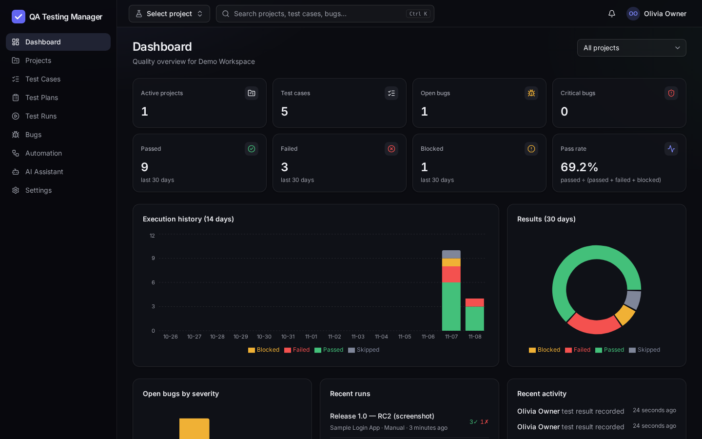
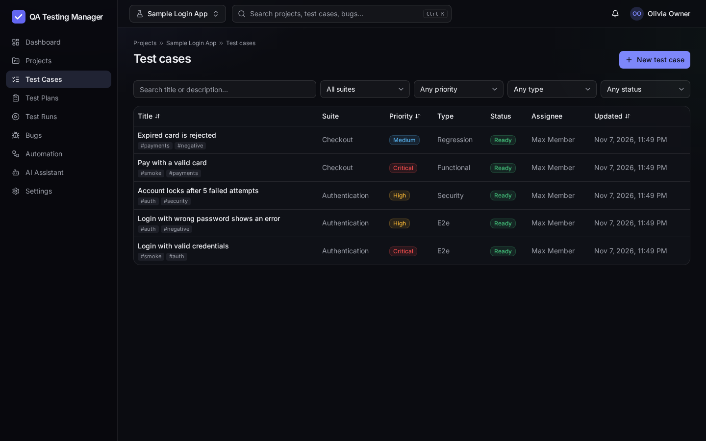
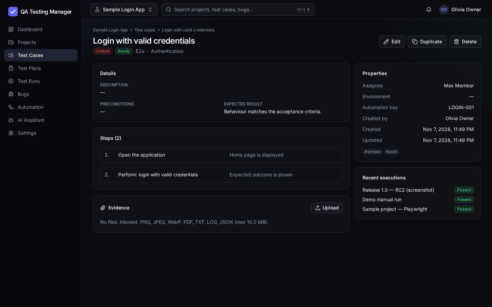
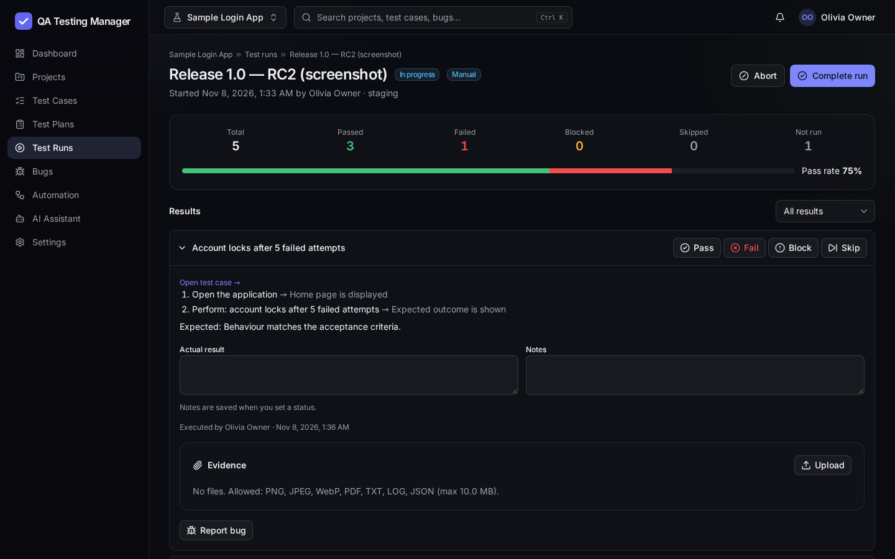
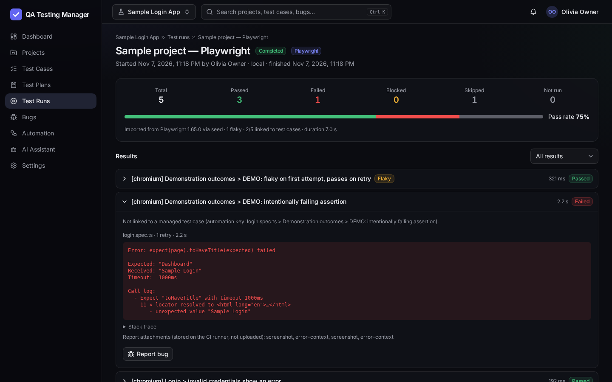
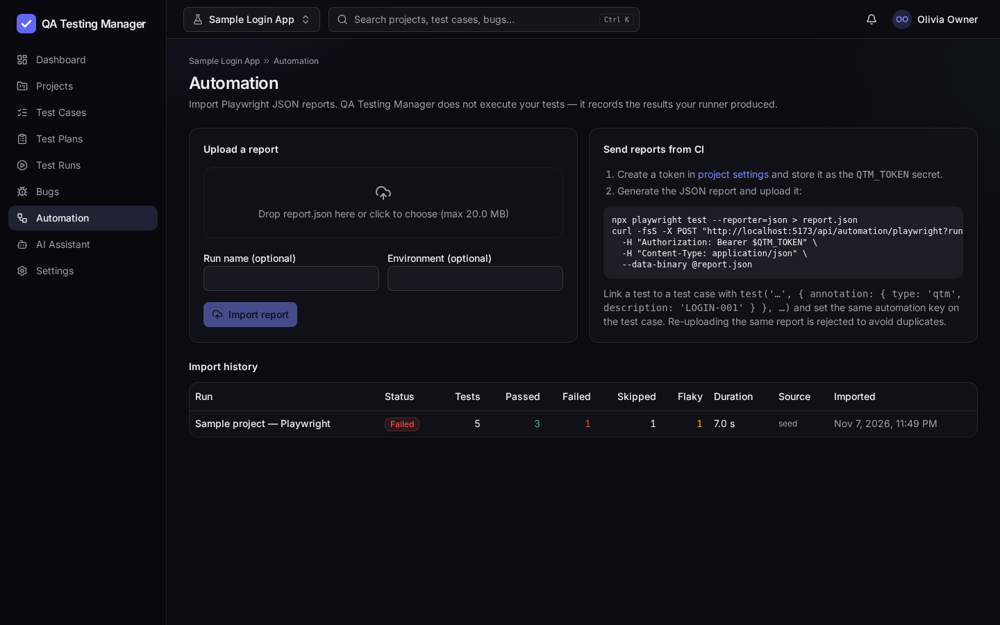
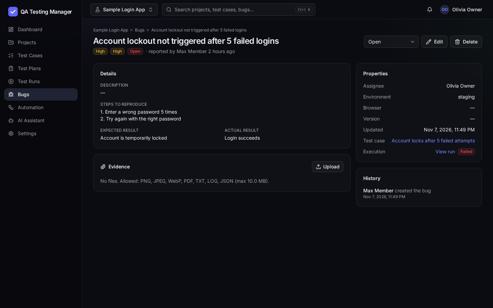
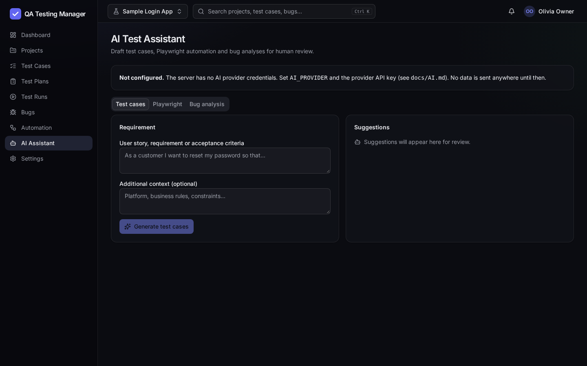
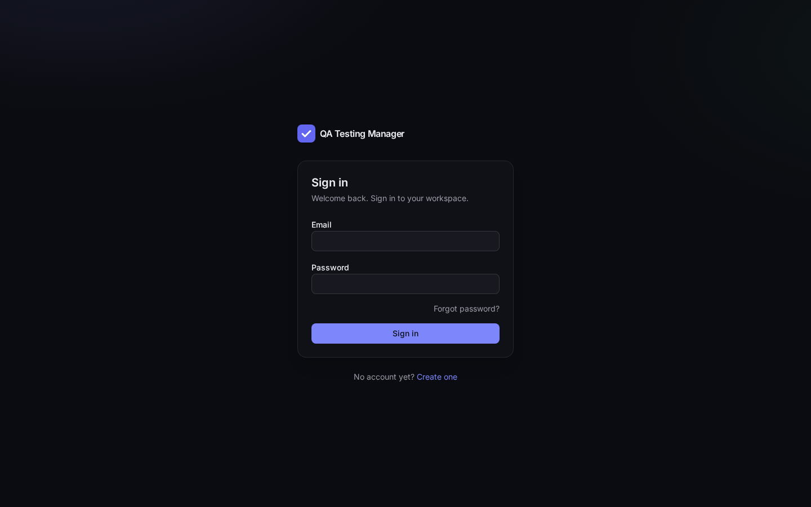

# QA Testing Manager

[](https://github.com/Fabianooliveirasilva/QA-Testing-Manager-/actions/workflows/ci.yml)

A multi-tenant SaaS for managing the software quality lifecycle — test cases, test plans, manual
runs, bug tracking with evidence, **Playwright report import from CI** and an **AI test assistant** —
built with the same rigor it helps teams apply: every feature is covered by unit, integration,
security, end-to-end and accessibility tests running against real infrastructure in CI.



> **Status:** feature-complete MVP, verified by an automated pipeline. Not yet deployed publicly —
> see [Known limitations](#known-limitations) and [docs/PROJECT_STATUS.md](docs/PROJECT_STATUS.md).

## Table of contents

[Features](#features) · [Architecture](#architecture) · [Tech stack](#tech-stack) ·
[Security](#security-highlights) · [Testing strategy](#testing-strategy) · [CI/CD](#cicd-pipeline) ·
[Getting started](#getting-started) · [Docker](#docker) · [Configuration](#environment-variables) ·
[Demo](#demo-walkthrough) · [Screenshots](#screenshots) · [Limitations](#known-limitations) · [Roadmap](#roadmap)

## Features

| Area | Highlights |
| --- | --- |
| **Dashboard** | Metrics computed from persisted data only: projects, cases, passed/failed/blocked (30 days), pass rate with an explicit formula, open/critical bugs, 14-day execution history, recent runs and activity; per-project filter. |
| **Projects** | Create, edit, archive (read-only) / restore, project lead, team, suites, CI API tokens. |
| **Test cases** | Steps, preconditions, expected result, priority, 8 test types, lifecycle status, tags, environment, assignee, automation key. Search, filter, sort, paginate, duplicate, soft-delete, evidence. |
| **Test plans & runs** | Plans built from suites and/or cases; manual execution with Pass/Fail/Block/Skip, actual result, notes, duration and evidence; runs are immutable once closed. Execution status never changes the test-case definition. |
| **Bug tracking** | Severity, priority, workflow status, environment/browser/version, reproduction steps, assignee, evidence, field-level change history, links to the failing case and execution. |
| **Playwright integration** | Import the official JSON reporter output from the UI or from CI with a scoped project token: passed/failed/flaky/skipped, retries, durations, errors, stack traces; duplicate-proof; results linked to test cases through annotations. The product *imports* results — it does not execute your tests. |
| **AI test assistant** | Test cases from requirements, Playwright code suggestions, bug analysis. Provider-agnostic, opt-in per organization, secrets redacted, structured output validated, per-user and per-organization daily quotas. Output is always a draft for human review. |
| **Organizations** | Multiple isolated workspaces per user, roles Owner/Admin/Member/Viewer, audit log. |

## Architecture

```
Browser (React SPA) ─/api─▶ nginx (prod) / Vite proxy (dev) ─▶ Express API ─▶ PostgreSQL 17
                                                                  ├─ StorageProvider (local disk; S3-ready interface)
                                                                  ├─ FileScanner     (malware-scan hook; none bundled)
                                                                  ├─ Mailer          (log mailer; SMTP-ready interface)
                                                                  └─ AiProvider      (Anthropic adapter; provider-agnostic)
CI pipeline of any project ─ Bearer token ─▶ POST /api/automation/playwright
```

- **pnpm monorepo:** `apps/api` (Express 5 + Prisma), `apps/web` (React 19 SPA), `packages/shared`
  (Zod contracts used by *both* API validation and web forms), `examples/playwright-sample`
  (a real Playwright project used to produce importable reports).
- **Tenancy:** every project resource is addressed through `/api/projects/:projectId/...`; the API
  checks organization membership on each request (non-members get 404) and every child query filters
  by both id and project.
- **Same-origin deployment** (nginx proxy) enables `HttpOnly` + `SameSite` session cookies and a strict CORS policy.

Details: [docs/ARCHITECTURE.md](docs/ARCHITECTURE.md) · decisions: [docs/DECISIONS.md](docs/DECISIONS.md) · API: [docs/API.md](docs/API.md)

## Tech stack

| Layer | Technologies |
| --- | --- |
| Web | React 19, TypeScript (strict), Vite 7, Tailwind CSS 4, shadcn/ui (Radix), TanStack Query 5, React Router 7, React Hook Form + Zod, Recharts |
| API | Node.js 22, Express 5, Prisma 6, PostgreSQL 17, Zod, Argon2id, Helmet, express-rate-limit, Multer + file-type, Pino |
| Testing | Vitest 4 (+ V8 coverage), Supertest, Playwright 1.65, axe-core |
| Delivery | Docker (multi-stage, non-root), Docker Compose, nginx, GitHub Actions |

## Security highlights

- **Broken access control:** organization isolation enforced server-side on every request; cross-tenant
  references in payloads rejected; RBAC matrix; tested with IDOR, privilege-escalation and mutation tests.
- **Authentication:** Argon2id; opaque server-side sessions (`HttpOnly`, `SameSite=Lax`, `Secure` in prod)
  with sliding + absolute expiry; CSRF token bound to the session; account lockout with constant-time
  responses; single-use, race-safe password reset that revokes all sessions.
- **Uploads:** extension allow-list + declared MIME + magic-byte verification, no SVG/HTML, sanitized
  names, random storage keys outside the web root, `nosniff` + sandbox CSP on download, malware-scanner hook
  (files are explicitly marked *not scanned* when no engine is configured).
- **Hardening:** Helmet + nginx CSP, strict CORS, payload limits, rate limits, generic errors with request
  ids, least-privilege database role in Docker, secrets only via environment, `pnpm audit` gate in CI.

Full threat mapping (OWASP Top 10) and known gaps: [docs/SECURITY.md](docs/SECURITY.md).

## Testing strategy

| Layer | What it proves | Where |
| --- | --- | --- |
| Unit | Report parsing, file validation, redaction, permissions, config safety, AI adapter error mapping (official SDK against a local API stub), UI utilities/components | `apps/*/src/**/*.test.ts(x)`, `packages/shared` |
| Integration / API | Real Express app + **real PostgreSQL**: business rules, persistence, dashboards, imports, concurrency (race conditions), health checks | `apps/api/tests` (`integration` project) |
| Security | IDOR across organizations, RBAC, CSRF, session expiry/revocation, lockout, reset tokens, upload attacks, SQL/XSS payloads, mass assignment, error hygiene | `apps/api/tests` (`security` project) |
| End-to-end | Real browser → Vite → API → PostgreSQL: full QA lifecycle, Playwright import, role-based UI, WCAG 2 A/AA scan with axe-core | `apps/web/e2e` |
| Infrastructure | Compose stack boots, migrates, serves through nginx, enforces DB least privilege, persists data across restarts, shuts down gracefully | `scripts/compose-smoke.sh` |

Only *external* vendors are replaced by test doubles (AI provider API, malware engine); everything
internal runs for real. Coverage is measured per package with ratchet thresholds — current numbers and
how to read them: [docs/TESTING.md](docs/TESTING.md).

## CI/CD pipeline

`.github/workflows/ci.yml` on every push and pull request:

1. **quality** — frozen-lockfile install → lint → type check → unit → integration → security → build → dependency audit
2. **coverage** — all suites with V8 coverage; thresholds enforced; summary published to the run page
3. **e2e** — Playwright against the real stack; HTML report and traces uploaded as artifacts
4. **docker** — builds both images and runs the Compose smoke test

Any failing step fails the pipeline (no `continue-on-error`).

## Getting started

Prerequisites: Node.js **22.12+**, pnpm **10** (`corepack enable`), and PostgreSQL 17 — via Docker, your
own server, or the bundled `pnpm db:start` (real PostgreSQL binaries from the `embedded-postgres` package).

```bash
pnpm install                 # also generates the Prisma client
cp .env.example .env         # works as-is with `pnpm db:start`; edit the URLs for your own server
pnpm db:start                # terminal 1 — PostgreSQL on :5432 with databases qtm_dev and qtm_test
pnpm db:deploy               # apply migrations
pnpm db:seed                 # optional demo workspace (refuses NODE_ENV=production)
pnpm dev:api                 # terminal 2 — API on http://localhost:4000
pnpm dev:web                 # terminal 3 — web on http://localhost:5173
```

Demo accounts after seeding: `owner@demo.qtm.local`, `member@demo.qtm.local`, `viewer@demo.qtm.local`
with password `SEED_PASSWORD` (default `DemoPassw0rd!2026`, **local development only**).

### Running the tests

```bash
pnpm lint && pnpm typecheck
pnpm test                                   # unit + integration + security (needs TEST_DATABASE_URL)
pnpm --filter @qtm/api test:security        # security suite only
pnpm test:coverage                          # with coverage + thresholds
pnpm --filter @qtm/web exec playwright install chromium   # once
pnpm test:e2e                               # starts API :4100 + web :5174 on TEST_DATABASE_URL
./scripts/compose-smoke.sh                  # requires Docker
```

## Docker

```bash
cp .env.docker.example .env.docker          # set strong passwords and your public URL
docker compose --env-file .env.docker up --build -d --wait
# → http://localhost:8080
docker compose --env-file .env.docker exec api node dist/cli/create-admin.js --email you@company.com --name "You" --org "Your Org"
docker compose --env-file .env.docker down  # add -v to delete database and uploads
```

The stack: PostgreSQL (health-checked, persistent volume, init script creating a DML-only app role) →
API (runs migrations with the owner role, then serves as the app role; non-root; tini; graceful
shutdown) → nginx (SPA + reverse proxy + security headers; unprivileged image).

## Environment variables

| Variable | Default | Purpose |
| --- | --- | --- |
| `DATABASE_URL` / `TEST_DATABASE_URL` | – | PostgreSQL connection (test DB name must contain `test`) |
| `NODE_ENV` | `development` | `production` enforces secure cookies and explicit URLs |
| `API_PORT` | `4000` | API port |
| `WEB_ORIGIN` | `http://localhost:5173` | CORS allow-list (comma separated); **required** in production |
| `APP_URL` | `http://localhost:5173` | Public URL used in password-reset links; **required** in production |
| `COOKIE_SECURE` | `false` | Must be `true` in production (HTTPS) |
| `TRUST_PROXY` | `false` | `true` behind one reverse proxy (client IP for rate limits) |
| `SESSION_TTL_HOURS` / `SESSION_ABSOLUTE_TTL_DAYS` | `12` / `7` | Sliding and absolute session lifetime |
| `REGISTRATION_ENABLED` | `true` | `false` for private deployments (use the admin CLI) |
| `STORAGE_LOCAL_DIR` | `./storage` | Evidence storage directory (persistent volume) |
| `AI_PROVIDER` / `AI_MODEL` / `ANTHROPIC_API_KEY` | `none` / `claude-opus-5-5` / – | AI assistant configuration |
| `AI_DAILY_LIMIT_PER_USER` / `AI_DAILY_LIMIT_PER_ORG` | `50` / `500` | AI quotas (UTC day) |
| `LOG_LEVEL` | `info` | Pino log level |

## Demo walkthrough

Seed the database, sign in as `owner@demo.qtm.local`, then:

1. **Login** — observe the generic error on a wrong password; the account locks after 5 attempts.
2. **Create a project** — *Projects → New project*; a default suite is created.
3. **Create a suite** — on the project page, add “Checkout”.
4. **Create test cases** — *Test Cases → New test case*: steps, priority, type, tags, automation key `LOGIN-001`.
5. **Manual execution** — *Test Plans → New plan* (include the suite) → *Start manual run* → Pass/Fail with notes and a screenshot as evidence.
6. **Register a bug** — from the failed result, *Report bug* (pre-linked); change its status and see the history.
7. **Import a Playwright report** — run `pnpm --filter @qtm/playwright-sample exec playwright test`, then upload `examples/playwright-sample/report.json` in *Automation*; inspect the failed, flaky and skipped results. Upload it again → rejected as duplicate.
8. **Dashboard** — all numbers update from the data you just created.

A longer script for presentations: [docs/DEMO.md](docs/DEMO.md).

## Screenshots

Captured from the running app with the demo seed by `pnpm --filter @qtm/web screenshots`
([script](apps/web/scripts/screenshots.ts)).

| | |
| --- | --- |
|  Test cases |  Test case detail |
|  Manual execution |  Imported Playwright run |
|  Automation & CI import |  Bug with history |
|  AI assistant (not configured state) |  Sign in |

## Known limitations

- **Not deployed**: no public demo URL yet. Deployment guide: [docs/DEPLOYMENT.md](docs/DEPLOYMENT.md).
- **E-mail**: no mail provider integrated; password-reset links are logged in development and **not delivered** in production.
- **AI**: the Anthropic adapter is tested against a local stub of the API; a live call has not been executed (requires an API key).
- **Malware scanning**: hook implemented, no engine bundled — uploads are validated by type/content and marked *not scanned*.
- **Scale-out**: rate limits are in memory (single instance); evidence is stored on local disk (one persistent volume).
- **Onboarding**: members must already have an account (no e-mail invitations); no MFA/SSO.

## Roadmap

1. SMTP/API mailer adapter → password reset in production and e-mail invitations.
2. S3-compatible storage driver and a ClamAV adapter for the existing `FileScanner` hook.
3. Redis-backed rate limiting for multiple API replicas.
4. Requirement traceability (cases ↔ user stories) and flaky-test trends across imports.
5. Remote test execution workers feeding the existing import pipeline.
6. MFA (TOTP) and SSO (OIDC).

## License

No license has been chosen yet; all rights reserved by the author until one is added.
